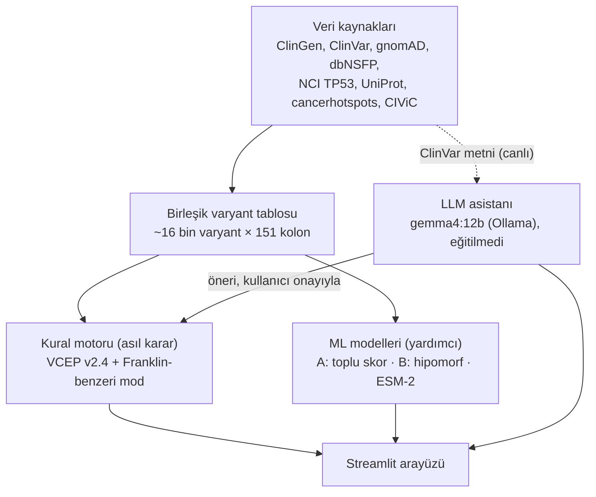

# TP53Varyant (TP53-Franklin)

TP53 genindeki germline varyantları **ClinGen TP53 uzman panelinin (VCEP v2.4) kurallarıyla** sınıflandıran,
[Franklin by Genoox](https://franklin.genoox.com) benzeri, açık veriyle çalışan bir varyant yorumlama aracı.
Kural motorunun yanında TP53'e özel makine öğrenmesi modelleri ve yerel bir dil modeliyle (LLM) ClinVar
metinlerinden klinik kanıt çıkarımı da içerir.

> Araştırma ve eğitim amaçlıdır. Klinik tanı veya tedavi kararı için kullanılmamalıdır.

📘 **Ayrıntılı, örnekli kullanım rehberi:** [docs/KULLANIM_REHBERI.md](docs/KULLANIM_REHBERI.md)
(ekranlar, klinik kanıt formu, LLM asistanı, kural / ML / LLM ayrımı, doğrulama yöntemi)

*English summary: An open-data, TP53-focused re-implementation of the Franklin variant interpretation page.
Classification follows the ClinGen TP53 VCEP v2.4 Bayesian point system; TP53-specific ML models and a local LLM
(Ollama) for evidence extraction from ClinVar submissions are added on top. Validated against 189 ClinGen expert
classifications (86.8 % agreement) and 879 ClinVar ≥2-star records (no opposite-direction calls).*

---

## Ne yapar?

Bir TP53 varyantı girildiğinde (`R248Q`, `c.743G>A`, `chr17-7577538-C-T`, `rs11540652` …) Franklin'deki
sekmelerin karşılığını üretir:

| Sekme | İçerik |
|---|---|
| ACMG Sınıflama | VCEP v2.4 puanı ve sınıfı, her kriterin gerekçesi ve kaynağı, Franklin-benzeri genel mod, ClinGen uzman kaydıyla karşılaştırma, klinik kanıt formu |
| Varyant Değerlendirme | Bölge görüntüleyici, ClinVar / eRepo / UniProt kayıtları, 28 in-silico aracın skoru ve TP53 içindeki yüzdeliği, gnomAD v4.1 alt popülasyon frekansları |
| Fonksiyon & ML | Kato, Funk, Giacomelli, Kotler, Kawaguchi test sınıfları; NCI fonksiyonel deney kayıtları; ML skorları |
| Yayınlar | NCI aile kayıtları, canlı PubMed araması |
| Gen Değerlendirme | Sonuç tipine göre sınıf dağılımı, hotspot kalıntıları, UniProt bölgeleri |
| İlişkili Hastalıklar | Varyant ve gen düzeyinde bildirilen durumlar |
| Somatik Klinik Kanıt | NCI tümör dağılımı, cancerhotspots, CIViC kanıtları |
| LLM Asistanı | ClinVar gönderim metinlerinden yerel LLM ile PS2/PS4/PP1/PP4/BS2 kanıt önerisi |
| Veri Kaynakları | İndirilen dosyalar ve doğrulama sonucu |

## Mimari



- **Kural motoru** karar verir; eğitim içermez, eşikler ve puanlar ClinGen spesifikasyonundan gelir.
- **ML modelleri** ek skor üretir, ACMG puanına eklenmez.
- **LLM** yalnızca öneri üretir; kullanıcı onaylamadan puana girmez. Uygulamada agent yoktur.

## Kurulum

Python 3.11+ önerilir.

```
git clone https://github.com/mehmetbozdemir24/TP53Varyant.git
cd TP53Varyant
pip install -r requirements.txt

python scripts/download.py      # ham veri setleri -> data/raw (~105 MB, MANIFEST.json ile)
python run_pipeline.py          # birleşik tablo + doğrulama + ML (~3 dk)
streamlit run app.py            # http://localhost:8501   (Windows: baslat.bat)
```

İsteğe bağlı:

```
python run_pipeline.py --esm2   # ESM-2 LLR'yi hesapla (GPU önerilir, model ~2.5 GB) ve ML'i yeniden eğit
ollama pull gemma4:12b          # LLM sekmesi için; farklı model: TP53_LLM_MODEL ortam değişkeni
```

## Veri kaynakları

| Kaynak | Kullanım |
|---|---|
| [ClinGen TP53 VCEP Tablo S1-S3](https://doi.org/10.1186/s13073-025-01536-3) | PVS1 splice gücü; her missense için Align-GVGD, BayesDel, SpliceAI ve PP3/BP4 kodu; fonksiyonel test sınıfları ve PS3/BS3 kodu |
| [MyVariant.info / dbNSFP](https://myvariant.info) | REVEL, AlphaMissense, BayesDel, VARITY, SIFT, PolyPhen-2, PrimateAI, ESM1b, EVE, CADD, dbscSNV ve diğerleri |
| [gnomAD v4.1](https://gnomad.broadinstitute.org) | Alel sayıları ve alt popülasyonlar; FAF95 burada hesaplanır |
| [ClinVar](https://www.ncbi.nlm.nih.gov/clinvar/) | Germline / onkojenite / somatik sınıflamalar, gönderim metinleri |
| [ClinGen eRepo](https://erepo.clinicalgenome.org/evrepo/) | 189 uzman sınıflaması (doğrulama, PS1/PM5, ML etiketleri) |
| [NCI TP53 Database r21](https://tp53.cancer.gov) | Somatik tümörler, germline aileler, fonksiyonel deneyler |
| [UniProt P04637](https://www.uniprot.org/uniprotkb/P04637) | Domainler, bağlanma yerleri, VAR_ kayıtları |
| [cancerhotspots.org v2](https://www.cancerhotspots.org) | Hotspot kalıntıları (PM1) |
| [CIViC](https://civicdb.org) | Somatik klinik kanıt |

Ham veriler depoya konmaz; `scripts/download.py` ile yeniden indirilir. Her dosyanın URL'si, indirme zamanı ve
md5'i `data/raw/MANIFEST.json`'a yazılır. Veri setlerinin kendi kullanım koşulları geçerlidir (ör. dbNSFP'nin bazı
skorları yalnızca akademik kullanıma açıktır).

## Sınıflandırma kuralları

ClinGen TP53 VCEP v2.4 ([CSpec GN009](https://cspec.clinicalgenome.org/cspec/ui/svi/doc/GN009)) Tavtigian Bayes
puan sistemi: Supporting 1, Moderate 2, Strong 4, Very Strong 8 (benign kriterler eksi).
Pathogenic ≥ 10 · Likely Pathogenic 6-9 · VUS -1..5 · Likely Benign -6..-2 · Benign ≤ -7.

| Otomatik (varyant verisinden) | Klinik (form, LLM önerisi veya eRepo uzman kaydı) | TP53'te uygulanmaz |
|---|---|---|
| PVS1, PS1, PS3, BS3, PM1, PM2, PM5, PP3, BP4, BP7, BS1, BA1 | PS2, PS4, PP1, PP4, BS2, BS4, BP2 | PM3, PM4, PM6, PP2, PP5, BP1, BP3, BP5, BP6 |

## Doğrulama

**ClinGen uzman paneli (189 varyant):** %86.8 aynı sınıf. Kriter uyumu PVS1 %97, PS3 %99, PM1 %97, PM2 %95,
PP3 %97, BA1/BS1 %100, PM5 %93, BP4 %73. Farkların çoğu uzman kayıtlarının eski spesifikasyonla (v2.0-2.2)
yapılmasından kaynaklanır.

**ClinVar ≥ 2 yıldız, eRepo dışı (879 varyant, yalnızca otomatik kanıt):**

| ClinVar | n | Uygulama P/LP | VUS | B/LB |
|---|---|---|---|---|
| P/LP | 399 | 358 (%90) | 41 | 0 |
| B/LB | 480 | 0 | 302 | 178 |

Ters yönlü hata yok. Benign tarafta temkinli kalınır, çünkü TP53'te benign kanıtın önemli kısmı klinik veridir (BS2).

**Franklin'in gerçek sitesi (7 varyant, 31.10.2026):** Franklin-benzeri mod 7 varyantın 6'sında aynı sınıfı veriyor
(R175H, R248Q, Y220C, R273H, R213*, P72R; fark: R337H).

**ML (kodon gruplu 5 katlı çapraz doğrulama):**

| Model | Görev | Sonuç |
|---|---|---|
| A – TP53 Aggregated Prediction (lojistik, kalibre) | P/LP vs B/LB, 407 missense | ROC-AUC 0.983 (AlphaMissense tek başına 0.990, REVEL 0.970, ESM-2 0.925) |
| B1 – sekans + yapı + in-silico (gradient boosting) | Kato sınıfı, 2.670 missense | Kısmen fonksiyonel AUC 0.72 · fonksiyonsuz AUC 0.91 |
| B2 – B1 + diğer fonksiyonel testler | Kato sınıfı | 0.77 · 0.92 |

**LLM (gemma4:12b, zero-shot):** R175H için ClinVar metinlerinden PS4_Moderate ve PP1_Moderate önerdi; ikisi de
ClinGen uzman kaydıyla aynı.

Yeniden üretmek için: `python scripts/validate_vcep.py` ve `python scripts/validate_clinvar.py`.

## Proje yapısı

```
app.py                  Streamlit arayüzü
run_pipeline.py         build + doğrulama + ML (+ --download, --esm2)
baslat.bat              Windows başlatıcı
tp53/
  common.py             HGVS yardımcıları, domainler, Grantham, kodon tablosu
  build.py              ham veriden birleşik tablo (data/processed/variants.parquet)
  acmg.py               VCEP v2.4 motoru + Franklin-benzeri mod + Richards 2015 birleştirme
  ml.py                 Model A ve Model B
  llm.py                ClinVar gönderimleri, Ollama ile kanıt çıkarımı, PubMed
scripts/
  download.py           veri indirme (MANIFEST.json)
  esm2_llr.py           ESM-2 maskeli marjinal LLR
  validate_vcep.py      ClinGen uzman sınıflamalarıyla karşılaştırma
  validate_clinvar.py   ClinVar ≥ 2 yıldız kayıtlarla karşılaştırma
  test_llm.py           LLM modülü testi
```

## Bilinen sınırlar

- PM2'de gnomAD alel dengesiyle (VAF < 0.35, klonal hematopoez) düzeltme otomatik değil.
- PM1, cancerhotspots.org'un anlamlı hotspot listesine dayanır.
- Tek amino asit delesyonları için VCEP BayesDel tablosu ve RNA tabanlı PVS1 bu sürümde yok.
- Franklin'in kendi ML bileşenleri kapalı kaynaktır; Franklin modu yaklaşık bir taklittir.
- ML etiketlerinde döngüsellik riski: bazı in-silico araçlar ClinVar ile eğitilmiştir.

## Kaynaklar

- Fortuno C, et al. *Genome Medicine* 2025. [doi:10.1186/s13073-025-01536-3](https://doi.org/10.1186/s13073-025-01536-3)
- ClinGen TP53 VCEP CSpec v2.4: <https://cspec.clinicalgenome.org/cspec/ui/svi/doc/GN009>
- Richards S, et al. *Genet Med* 2015;17:405-424.
- Tavtigian SV, et al. *Hum Mutat* 2020;41:1734-1737.
- Franklin yardım merkezi: <https://help.genoox.com/en/collections/2537985-franklin-acmg-automated-classification>

## Yazar

Mehmet Bozdemir
