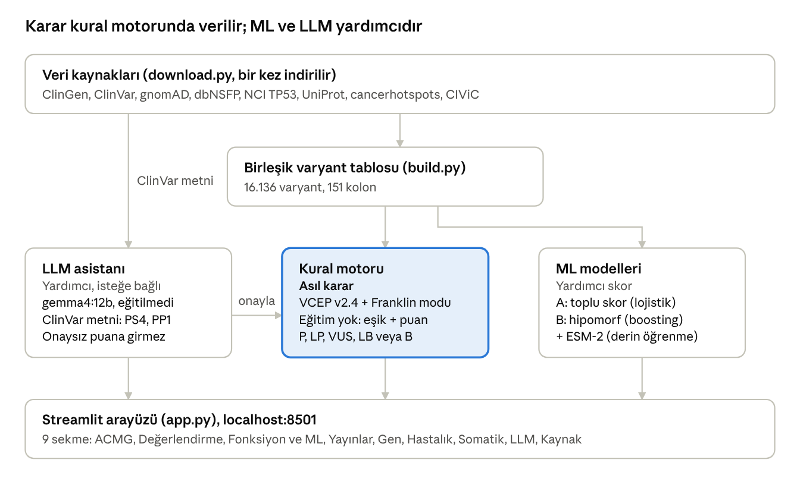

# TP53-Franklin Kullanım Rehberi

Mehmet Bozdemir · 31 Ekim 2026

## İçindekiler

- [Bu uygulama ne yapıyor](#bu-uygulama-ne-yapıyor)
- [1. Başlatma ve varyant yazma](#1-başlatma-ve-varyant-yazma)
- [2. Ekran rehberi (örnek: R248Q)](#2-ekran-rehberi-örnek-r248q)
- [3. LLM Asistanı sekmesi](#3-llm-asistanı-sekmesi)
- [4. Hangi kısım kural, hangi kısım ML, hangi kısım LLM](#4-hangi-kısım-kural-hangi-kısım-ml-hangi-kısım-llm)
- [5. Gerçekten çalışıyor mu](#5-gerçekten-çalışıyor-mu)
- [6. Sık sorulanlar ve bilinen sınırlar](#6-sık-sorulanlar-ve-bilinen-sınırlar)
- [Kaynaklar](#kaynaklar)

## Bu uygulama ne yapıyor

TP53-Franklin, Franklin'in bir varyant için gösterdiği her şeyi yalnızca TP53 için, açık veriyle ve TP53 uzman panelinin kurallarıyla üretir. Üç katmanı vardır. Pathogenic, VUS veya Benign kararını kural motoru verir. ML modelleri ek skor üretir, LLM ise klinik kanıtı bulmana yardım eder; ikisi de kararı kendi başına değiştirmez.

Veri bir kez indirilir ve tek bir tabloda birleştirilir. Bir varyant yazdığında uygulama sadece bu tablodan okur; internete yalnızca LLM ve PubMed düğmeleri çıkar.

## 1. Başlatma ve varyant yazma

Uygulamayı açmak için proje klasöründeki `baslat.bat` dosyasına çift tıkla (veya `streamlit run app.py`); tarayıcıda http://localhost:8501 açılır. İlk kurulumda önce `python scripts/download.py` ve `python run_pipeline.py` çalıştırılmalıdır (bkz. README).

Sol taraftaki kutuya istediğin TP53 varyantını yazabilirsin; örnek düğmeleri sadece kısayol. Uygulama aşağıdaki yazımların hepsini aynı varyanta çevirir. Tabloda olmayan bir varyant yazarsan "bulunamadı" der; bu durumda çoğunlukla yazım farklıdır ya da varyant hiçbir veri tabanında yoktur.

| Yazım türü | Örnek | Açıklama |
| --- | --- | --- |
| Protein, kısa | R248Q | En kolayı. Arg 248 → Gln. Stop için R213* |
| Protein, uzun | p.Arg248Gln | HGVS protein notasyonu |
| cDNA | c.743G>A | NM_000546.6 transkriptine göre |
| Gen + cDNA | TP53:c.743G>A | Franklin'in başlığındaki yazım |
| hg19 koordinat | chr17-7577538-C-T | Franklin'in URL'sindeki yazım |
| hg38 koordinat | 17-7674220-C-T | gnomAD'ın yazımı |
| dbSNP | rs11540652 | rs numarası |
| İntronik / splice | c.375+1G>A | Ekson-intron sınırı varyantları |
| Delesyon / frameshift | c.215del | Çerçeve kayması |

Aynı protein değişimine giden birden fazla DNA değişimi olabilir (örneğin P72R). Bu durumda sol tarafta bir seçim kutusu çıkar ve uygulama en çok kanıtı olan tek nükleotid değişimini önce gösterir.

## 2. Ekran rehberi (örnek: R248Q)

Bu bölümdeki tüm sayılar R248Q (c.743G>A) yazıldığında ekranda görünen değerlerdir.

### Başlıktaki linkler

Hepsi veri tabanı. Uygulama bu veri tabanlarının indirilmiş kopyalarını kullanır; linkler karşılaştırma yapabilmen için aynı varyantın o sitedeki orijinal sayfasını açar.

| Link | Veri tabanı | Orada ne var | Uygulamada nerede kullanılıyor |
| --- | --- | --- | --- |
| rs11540652 | dbSNP (NCBI) | Varyantın kimlik numarası | Sadece kimlik ve arama |
| ClinVar | ClinVar (NCBI) | Laboratuvarların gönderdiği sınıflamalar ve yorum metinleri | Klinik kanıt kartı, ML etiketleri, LLM asistanı |
| gnomAD | gnomAD v4.1 | Yaklaşık 800 bin sağlıklı kişide görülme sıklığı | PM2, BS1, BA1 kuralları |
| Franklin | Franklin (Genoox) | Aynı varyantın Franklin sayfası | Karşılaştırma için |
| ClinGen eRepo | ClinGen uzman paneli kayıtları | TP53 uzman panelinin resmi sınıflaması | Altın standart, PS1/PM5, doğrulama |
| NCI TP53 | NIH NCI TP53 veri tabanı | Tümör ve aile kayıtları, fonksiyonel testler | Somatik sekme, fonksiyon sekmesi |

### Sekmeler

| Sekme | Ne gösterir | Franklin'deki karşılığı |
| --- | --- | --- |
| ACMG Sınıflama | Varyantın Pathogenic / VUS / Benign sınıfı ve gerekçeleri | Franklin ACMG Classification |
| Varyant Değerlendirme | Bölge grafiği, klinik kayıtlar, 28 tahmin aracının skoru, popülasyon frekansı | Variant Assessment |
| Fonksiyon & ML | Laboratuvar fonksiyon testleri ve bizim eğittiğimiz modellerin skorları | Franklin'de yok |
| Yayınlar | NCI aile kayıtlarının makaleleri, canlı PubMed araması | Publications |
| Gen Değerlendirme | TP53 genelinde dağılımlar, hotspot kalıntılar | Gene Assessment |
| İlişkili Hastalıklar | Varyant ve gen için bildirilen hastalıklar | Associated Conditions |
| Somatik Klinik Kanıt | Tümör türleri, CIViC kanıtları | Somatic Clinical Evidence |
| LLM Asistanı | ClinVar metinlerinden yapay zekâ ile kanıt çıkarma | Franklin bunu arka planda yapıyor |
| Veri Kaynakları | İndirilen dosyalar ve doğrulama sonucu | Yok |

### ACMG Sınıflama sekmesi nasıl okunur

Sekmenin üstündeki renkli şerit sonucu verir. R248Q için: Pathogenic, +20 puan. Her kriter puan ekler veya çıkarır; 10 ve üstü Pathogenic, 6-9 Likely Pathogenic, -1 ile 5 arası VUS, -2 ile -6 arası Likely Benign, -7 ve altı Benign sayılır.

Sağdaki kartlar üç ayrı sonucu yan yana koyar:

- Yalnızca otomatik kanıtlar: sadece varyantın kendi verisiyle hesaplanan sonuç. R248Q için Likely Pathogenic, +8 (PS3, PM1, PP3, PM2_Supporting).
- Franklin-benzeri genel ACMG: Franklin'in kurallarıyla sonuç. R248Q için Pathogenic.
- ClinGen uzman paneli: gerçek uzmanların verdiği karar. R248Q için Pathogenic.

### Kanıt görünümü nedir

Sayfanın altındaki kriter kartlarını iki farklı kural setine göre gösterir. "ClinGen TP53 VCEP v2.4" seçiliyken TP53'e özel uzman kurallarının kartları görünür; asıl sonuç budur. "Franklin-benzeri genel ACMG" seçilince aynı varyant Franklin'in genel kurallarıyla değerlendirilir. İkisini karşılaştırarak Franklin'in neden farklı bir sonuç verdiğini görebilirsin. Örneğin R248Q'da Franklin PM2'yi Moderate, uzman kuralları ise sadece Supporting sayıyor.

Her kartta kod (PS3), güç (Strong), puan (+4), gerekçe ve veri kaynağı yazar. Kartın altındaki "KARŞILANMAYAN" satırı, o grupta neden başka kriterin uygulanmadığını açıklar.

### Klinik kanıt ekle ne demek

ACMG kriterlerinin bir kısmı varyantın kendisinden değil, hastalardan ve ailelerden gelir: "bu varyant kaç Li-Fraumeni ailesinde görüldü, ailede hastalıkla birlikte mi taşınıyor, de novo mu ortaya çıktı" gibi. Bunları hiçbir veri tabanından otomatik hesaplayamayız. Bu form, elinde hasta veya literatür bilgisi varsa onu girmen içindir.

| Form alanı | Kriter | Ne yazılır |
| --- | --- | --- |
| De novo probandlar | PS2 | Anne-babada olmayıp çocukta ortaya çıkan vakalar, kanser türüne göre |
| Chompret / Classic LFS / HER2+ | PS4 | Li-Fraumeni kriterlerini karşılayan akrabasız hasta sayısı |
| Kosegregasyon meiozu | PP1 | Ailede varyantın kanserle birlikte kaç nesilde geçtiği |
| VAF %5-35 | PP4 | Kanda düşük oranda görülen (klonal hematopoez) gözlemler |
| 60 yaş üstü kansersiz kadın | BS2 | Hastalık beklenirken sağlıklı kalan taşıyıcılar |
| Segregasyon yok / trans | BS4 / BP2 | Benign yönünde aile kanıtı |

Örnek: R248Q için uzman kaydını kapatıp (kutudaki işareti kaldırıp) Chompret 3, Classic LFS 1 ve meioz 5 girersen, PS4 2.5 puandan Moderate ve PP1 Moderate eklenir. Sonuç +8'den +12'ye çıkar ve sınıf Likely Pathogenic'ten Pathogenic'e döner.

Varsayılan olarak kutu işaretlidir: varyant ClinGen uzman kayıtlarında varsa ve sen bir şey girmediysen, uzmanların klinik kodları kullanılır. R248Q'nun +20 puanının 12'si bu kodlardan (PS2, PS4, PP1_Moderate, PP4_Moderate) gelir.

## 3. LLM Asistanı sekmesi

Bu sekme, klinik kanıt formunu senin yerine doldurmaya çalışır: ClinVar'daki laboratuvar yorumlarını okuyup içlerindeki hasta ve aile sayılarını çıkarır.

### ClinVar gönderimi nedir

ClinVar'a her laboratuvar bir varyant hakkında kendi kararını gönderir; her birine gönderim (SCV numarası) denir. Bir gönderimde sınıf (Pathogenic gibi), tarih ve çoğu zaman serbest metinle yazılmış bir gerekçe bulunur. Örneğin Ambry Genetics'in R175H gönderimi şöyle başlar: "The p.R175H pathogenic mutation, located in coding exon 4 of the TP53 gene..." ve devamında kaç ailede görüldüğünü, hangi fonksiyonel testlerin yapıldığını anlatır.

### "61 gönderim, 55 tanesinde serbest metin var" ne demek

R248Q için 61 ayrı laboratuvar kaydı var. Bunların 55'i bir açıklama metni yazmış; 6'sı sadece "Pathogenic" deyip gerekçe vermemiş. LLM sadece metni olanları okuyabilir. İçerik bakımından boş olanlar ("not provided" gibi) atılır ve aile, de novo, Li-Fraumeni gibi anahtar kelime geçenler öne alınır. Yerel modelin okuyabileceği metin sınırlı olduğu için en bilgili 8-10 gönderim gönderilir.

### Üç düğme ne yapar

1. ClinVar gönderimlerini getir: NCBI'dan bu varyantın tüm gönderimlerini canlı olarak indirir ve tablo halinde gösterir. İnternet gerekir, LLM kullanılmaz.
2. LLM ile klinik kanıt çıkar: metinleri bilgisayarındaki Ollama'da çalışan gemma4:12b modeline gönderir ve şu soruların cevabını yapılandırılmış olarak ister: kaç de novo vaka var, kaç proband Chompret veya Classic LFS kriterini karşılıyor, kaç meiozda kosegregasyon var, düşük VAF gözlemi var mı, hangi fonksiyonel testler anlatılmış. Her sayı için metinden alıntı ister. RTX 3070 Ti'lı bir bilgisayarda yaklaşık 100 saniye sürüyor.
3. Öneriyi klinik forma uygula: LLM'in bulduğu sayıları ACMG sekmesindeki forma yazar. Bu düğmeye basmadan hiçbir LLM çıktısı puana katılmaz; önce alıntıları okuyup kontrol etmelisin.

Gerçek test sonucu (R175H): LLM 49 gönderimin en bilgili 8'ini okudu ve 3 Chompret + 1 Classic LFS proband, 5 meioz ve 1 düşük VAF gözlemi buldu. Bu sayılar formda PS4_Moderate ve PP1_Moderate üretiyor; ClinGen uzman panelinin bu varyant için verdiği kodlar da tam olarak bunlar. Tek fark, LLM'in fazladan bir düşük VAF gözlemi sayması (PP4); bu yüzden çıktı her zaman kontrol edilmeli.

Alttaki "Sınıflandırmayı Türkçe açıkla" düğmesi, kararı bir klinik rapor paragrafı gibi Türkçe özetler. Yeni bilgi üretmemesi, sadece karşılanan kriterleri anlatması istenir.

## 4. Hangi kısım kural, hangi kısım ML, hangi kısım LLM

Kısa cevap: asıl sınıflandırma kural tabanlıdır, tıpkı Franklin ve ClinGen'de olduğu gibi. ML ve LLM yardımcı katmanlardır; ikisi de sınıflandırma puanını kendiliğinden değiştirmez.

| Parça | Türü | Biz mi eğittik | Ne işe yarar |
| --- | --- | --- | --- |
| ACMG motoru (VCEP v2.4) | Kural tabanlı (if-then eşikleri + puan) | Eğitim yok; kurallar ClinGen'den | Pathogenic/VUS/Benign kararı |
| Franklin-benzeri mod | Kural tabanlı | Eğitim yok; kurallar Franklin yardım sayfalarından | Karşılaştırma |
| Model A: TP53 Aggregated Prediction | Klasik ML (lojistik regresyon, kalibre) | Evet, 407 etiketli TP53 missense ile | Franklin'in "Aggregated Prediction" skorunun TP53'e özel karşılığı |
| Model B1/B2: fonksiyon / hipomorf | Klasik ML (gradient boosting ağaçları) | Evet, Kato sınıfı olan 2.670 varyantla | Varyantın fonksiyonel, kısmen fonksiyonel (hipomorf) veya fonksiyonsuz olma olasılığı |
| ESM-2 (650M parametre) | Derin öğrenme (protein dil modeli, transformer) | Hayır; Meta'nın hazır eğitilmiş modeli. Biz sadece çalıştırdık | Her missense için evrimsel "tuhaflık" skoru; ML'e özellik olarak girer |
| AlphaMissense, PrimateAI, ESM1b, VARITY, EVE | Derin öğrenme / ML araçları | Hayır; skorları hazır indirildi | Tahminler tablosu ve ML özellikleri |
| gemma4:12b (Ollama) | Büyük dil modeli | Hayır; hazır model, hiç ince ayar yapılmadı (zero-shot) | ClinVar metninden sayı çıkarma, Türkçe özet |

### gemma4:12b eğitildi mi

Hayır. Model olduğu gibi kullanılıyor; ona sadece iyi yazılmış bir talimat (prompt) ve çıktı biçimi (JSON şeması) veriliyor. İleride elle doğrulanmış örneklerle ince ayar (SFT/DPO) yapılabilir.

### Derin öğrenme var mı

Bizim eğittiğimiz modeller klasik ML'dir (lojistik regresyon ve gradient boosting). Derin öğrenme iki yerde var: ESM-2'yi GPU'da çalıştırıp her varyant için skor ürettik; AlphaMissense gibi hazır derin öğrenme araçlarının skorlarını da özellik olarak kullanıyoruz. Klasik ML'in seçilme sebebi veri miktarı: 407 etiketli örnekle derin bir ağ eğitmek aşırı öğrenmeye (overfitting) gider.

### Agent var mı

Uygulamanın içinde agent yok. LLM tek adımlı bir iş yapıyor: metni alıp JSON döndürüyor; kendi başına araç seçmez, internette gezmez, karar vermez. Agent'lık iş, uygulamayı kurarken yapılan geliştirme sürecindeydi: siteleri inceleme, veri indirme, kod yazma, test etme. Uygulama çalışırken bunların hiçbiri yoktur.

### Bir varyant girildiğinde arka planda ne oluyor

1. Yazım çözülür (R248Q → c.743G>A).
2. Hazır birleşik tablodan o varyantın satırı alınır (151 kolon: skorlar, frekanslar, kayıtlar). İnternete gidilmez.
3. Kural motoru her kriteri eşiklerle kontrol eder, puanları toplar, sınıfı verir.
4. ML skorları önceden hesaplanmış tablodan okunur.
5. LLM sadece sen düğmeye basınca çalışır.

## 5. Gerçekten çalışıyor mu

Evet, ama "doğru" sözünü ölçerek söylüyoruz. Uygulama dört farklı gerçek kaynakla karşılaştırıldı. Ters yönlü hata (patojeniki benign ya da benigni patojenik demek) hiçbir karşılaştırmada görülmedi; fark olduğunda uygulama genellikle temkinli kalıp VUS diyor.

### 5.1 ClinGen uzman paneliyle (altın standart)

ClinGen TP53 uzman panelinin elle sınıfladığı 189 varyantın 164'ünde (%86.8) aynı sınıf çıktı. Kriter bazında uyum: PVS1 %97, PS3 %99, PM1 %97, PM2 %95, PP3 %97, BA1 ve BS1 %100, PM5 %93, BP4 %73.

Farkların çoğu bir hata değil, sürüm farkı. Uzman kayıtlarının yarısı 2020-2023 arasındaki v2.0-2.2 kurallarıyla yapılmış; uygulama ise Kasım 2025'teki v2.4'ü kullanıyor. Örneğin Funk 2025 fonksiyon testi eski kayıtlarda yok. BP4 farkının sebebi de bu: yayımlanmış tablo bazı varyantlara BP4_Moderate veriyor, oysa eRepo'daki 75 uzman kaydının hiçbirinde BP4_Moderate etiketi yok.

### 5.2 ClinVar'daki güvenilir kayıtlarla

Uzman paneline girmemiş ama ClinVar'da en az 2 yıldızlı (birden fazla laboratuvarın hemfikir olduğu) 879 varyant alındı. Bu testte sadece otomatik kanıtlar kullanıldı; hasta ve aile bilgisi yok.

| ClinVar'ın kararı | Varyant | Uygulama P/LP | Uygulama VUS | Uygulama B/LB |
| --- | --- | --- | --- | --- |
| Pathogenic / Likely pathogenic | 399 | 358 (%90) | 41 | 0 |
| Benign / Likely benign | 480 | 0 | 302 | 178 (%37) |

Patojenik varyantların %90'ı hiçbir hasta bilgisi girmeden doğru bulunuyor. Benign tarafta uygulama çoğu zaman VUS diyor; çünkü TP53 kurallarında benign demek için genelde yüksek popülasyon frekansı (BA1/BS1) veya 60 yaşını kansersiz geçmiş taşıyıcı bilgisi (BS2) gerekiyor ve BS2 klinik veridir. Bu davranış klinik açıdan istenen yönde: emin olmadığında benign demiyor.

### 5.3 Franklin'in gerçek sitesiyle

Yedi varyantın Franklin sayfası açılıp sonucu okundu (31 Ekim 2026).

| Varyant | Franklin (gerçek site) | Bizim Franklin-benzeri mod | Bizim VCEP sonucu | ClinGen uzman paneli |
| --- | --- | --- | --- | --- |
| R175H | Pathogenic | Pathogenic | Pathogenic (12) | Pathogenic |
| R248Q | Pathogenic | Pathogenic | Pathogenic (20) | Pathogenic |
| Y220C | Pathogenic | Pathogenic | Pathogenic (21) | Pathogenic |
| R273H | Pathogenic | Pathogenic | Pathogenic (18) | Pathogenic |
| R213* | Pathogenic | Pathogenic | Likely Pathogenic (9) | kayıt yok |
| R337H | Pathogenic | Likely Pathogenic | VUS (1) | kayıt yok |
| P72R | Benign | Benign | Benign (-10) | kayıt yok |

Franklin-benzeri mod 7 varyantın 6'sında Franklin'le aynı sınıfı veriyor. VCEP sonucunun Franklin'den düşük kaldığı iki varyantın sebebi aynı: Franklin ClinVar metinlerinden PS2, PS4, PP1, PP4 gibi klinik kanıt çıkarıyor; bizde bu iş LLM sekmesinde ve kullanıcının onayına bırakılmış. R337H özel bir durum: Brezilya'da yaygın, düşük penetranslı bir kurucu varyant. Franklin burada ClinVar metinlerinden PS4_Strong çıkarıyor; bizim Franklin modu ise NCI aile sayısından yalnızca PS4_Moderate verebiliyor ve bu yüzden bir basamak aşağıda kalıyor.

Franklin'in R248Q için gerçek kriterleri: PS3, PS2, PS4_Moderate, PP1_Moderate, PP4_Moderate, PM1, PM2, PM5, PP3_Supporting, PP5. Bizim Franklin modu bunlardan PS3, PS4, PM1, PM2, PM5, PP3 ve PP5'i otomatik buluyor; PS2, PP1 ve PP4 ise klinik metinden gelen kanıtlar.

### 5.4 ML modelleri

Modeller eğitimde görmedikleri varyantlarla ölçüldü. Aynı kodondaki varyantlar hep aynı grupta tutuldu; böylece model komşu varyanttan "kopya çekemedi". Model A'nın ROC-AUC değeri 0.983. Karşılaştırma için tek başına AlphaMissense 0.990, BayesDel 0.978, REVEL 0.970, ESM-2 0.925. Yani bizim model iyi ama AlphaMissense'i geçmiyor. Hipomorf modeli (B1) kısmen fonksiyonel sınıfında AUC 0.72; bu en zor problem ve geliştirmeye açık.

### 5.5 Kendin nasıl kontrol edersin

1. Uygulamada bir varyant aç, başlıktaki Franklin ve ClinGen eRepo linklerine tıkla, sonuçları yan yana koy.
2. "Veri Kaynakları" sekmesinin altında uzman paneliyle karşılaştırma tablosu duruyor.
3. Komut satırında `python scripts/validate_vcep.py` ve `python scripts/validate_clinvar.py` çalıştır; varyant varyant farklar `data/processed/` altındaki CSV dosyalarına yazılır.
4. Bir varyantın tahmin skorlarını Franklin'in Predictions bölümüyle karşılaştır: R175H için REVEL 0.922, AlphaMissense 0.986, SpliceAI 0.01, iki tarafta da aynı.

## 6. Sık sorulanlar ve bilinen sınırlar

### Sık sorulanlar

- Uygulama internet olmadan çalışır mı? Evet. Sınıflama, tahminler ve grafikler indirilmiş tablodan gelir. Sadece "ClinVar gönderimlerini getir" ve "PubMed'de ara" düğmeleri internet ister.
- Veriler eskirse ne olur? `python run_pipeline.py --download` tüm veri setlerini yeniden indirip tabloyu ve modelleri yeniden kurar (yaklaşık 3-4 dakika).
- Neden "Yalnızca otomatik kanıtlar" sonucu daha düşük? Klinik kriterler (PS2, PS4, PP1, PP4) toplam puanın büyük kısmını oluşturur ve hasta bilgisi olmadan hesaplanamaz. Hotspot bir missense bile otomatik olarak genelde Likely Pathogenic'te kalır.
- ML skoru yüksekse sınıf değişir mi? Hayır. ML skoru bilgi olarak gösterilir, ACMG puanına eklenmez. Bunun için önce modelin ClinGen'in istediği şekilde kalibre edilmesi gerekir (olabilirlik oranı çerçevesi); bu ileriki bir adım.
- LLM yanlış sayı bulursa? Bu yüzden çıktı öneri olarak gösterilir ve her sayı için metinden alıntı istenir. Alıntıyı okumadan "forma uygula" düğmesine basma.
- Somatik (tümör) varyantlar için kullanılabilir mi? Sınıflama kuralları germline Li-Fraumeni içindir. Somatik sekme tümör verisini ve CIViC kanıtlarını gösterir ama tedavi önerisi yapmaz.
- Bu uygulama klinikte kullanılabilir mi? Hayır. Araştırma ve eğitim amacıyla yapıldı; klinik karar sertifikalı laboratuvar ve uzmanların işidir.

### Bilinen sınırlar

- PM2'de, uzman panelinin önerdiği gnomAD alel dengesi (VAF < 0.35, klonal hematopoez) düzeltmesi otomatik yapılmıyor.
- PM1 cancerhotspots.org'un anlamlı hotspot listesine dayanıyor. Listede olmayan kalıntılarda sayı eksik kalabilir; NCI'nin sayısı bilgi olarak gösteriliyor.
- Tek amino asit delesyonları için uzman panelinin BayesDel tablosu ve RNA deneyine dayalı PVS1 (örneğin c.375+5G>A) bu sürümde yok.
- Franklin modu yaklaşık bir taklit; Franklin'in kendi PM1 modeli ve ClinVar metin madenciliği kapalı kaynak.
- ML etiketlerinde döngüsellik riski var: REVEL ve VARITY gibi araçlar da ClinVar'la eğitildi.
- Yerel LLM (gemma4:12b) 8 GB GPU'ya tam sığmadığı için bir çıkarım yaklaşık 100 saniye sürüyor.

## Kaynaklar

- [ClinGen TP53 VCEP CSpec v2.4 (GN009)](https://cspec.clinicalgenome.org/cspec/ui/svi/doc/GN009)
- [Fortuno ve ark., Genome Medicine 2025 ve Tablo S1-S3](https://doi.org/10.1186/s13073-025-01536-3)
- [ClinGen Evidence Repository](https://erepo.clinicalgenome.org/evrepo/)
- [Franklin yardım merkezi, ACMG kuralları](https://help.genoox.com/en/collections/2537985-franklin-acmg-automated-classification)
- [Franklin R248Q sayfası](https://franklin.genoox.com/clinical-db/variant/snp/chr17-7577538-C-T?app=acmg-classification)
- [ClinVar R248Q (VCV 12356)](https://www.ncbi.nlm.nih.gov/clinvar/variation/12356/)
- [gnomAD v4.1](https://gnomad.broadinstitute.org/)
- [NCI TP53 Database](https://tp53.cancer.gov/)
- [MyVariant.info / dbNSFP](https://myvariant.info/)
- [cancerhotspots.org](https://www.cancerhotspots.org/)
- [CIViC](https://civicdb.org/)
- [ESM-2 (facebook/esm2_t33_650M_UR50D)](https://huggingface.co/facebook/esm2_t33_650M_UR50D)
